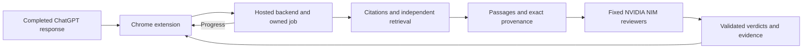

# Architecture

VerifAI 0.1.19 consists of a Chrome Manifest V3 extension and one Python verification service. The extension supports HTTPS `chatgpt.com` and `chat.openai.com` pages. The configured backend is the existing Render service. Chat models use NVIDIA NIM's fixed hosted endpoint. Credentials and prompts remain internal to the service.

## Chrome extension

`manifest.json` declares storage, sidePanel and alarms; content-script host access is restricted to the two supported ChatGPT hosts. The hosted service origin is an optional permission. There is no all-sites permission. The packaged endpoint is fixed to the existing hosted service.

`content.js` detects supported completed assistant responses, associates citations and revisions, and displays inline states. The worker rechecks active-tab, URL, response identity and revision before submission. Stale Re-verify replies cannot overwrite a different displayed run. Unsupported sites do not activate verification. Pausing is automatic when eligibility or ownership is lost; it does not cancel already accepted remote work.

`worker.js` owns signed-session credentials and owner-bound job/result state in trusted-context `chrome.storage.session`. It performs bounded polling and alarm-based recovery. The side panel presents only its owning response; lifecycle reconciliation handles tab/window/visibility changes. Alarms and session state support worker recovery, but actual worker-only suspension is a separate native acceptance check.

Settings manages the optional local history in `chrome.storage.local`. Only validated completed results with an explicit retention selection are saved. History is limited to 100 records and a bounded approximately 1 MB serialized budget. Expiry/pruning occurs when accessed/updated; manual deletion does not erase transient session state or external service data. See [PRIVACY.md](PRIVACY.md) for defaults, restart behavior and retention.

## Backend and jobs

`server.py` exposes `/health`, `/v1/session`, `/v1/verify` and owner-protected `/v1/jobs/{id}`. Exact origin checks supplement short-lived HMAC-signed anonymous sessions. The owner identifier is not an account identity. Requests have strict schemas and limits; wrong ownership and missing jobs are not exposed. Sessions last 15 minutes; jobs expire 30 minutes after creation and are removed through cleanup. The server is single-process: in-memory limits and job storage are not distributed controls, and a restart loses jobs.

The service admits at most two verification jobs and bounds HTTP completion waits. Versioned progress snapshots contain stages/counts/elapsed events, not factual content. The client distinguishes pending, paused, retrying, failed, incomplete and completed results. Network and model deadlines can exceed the UI's target; the 30-second target is not a verdict rule. Optional runtime/causal diagnostics default Off and remain behind existing origin/session checks.

## Evidence acquisition

`Models.extract` uses code-owned instructions and strict JSON validation to extract assertions and exact response quotations. Entity/measurement preservation is requested and provenance checked; semantic extraction remains model-dependent.

`Engine` checks cited URLs separately from independently discovered destinations. Discovery sends the standalone claim and a second ` official source` query to the configured search path. Search snippets are hints, not evidence. If acquired independent sources are unusable, the engine owns one bounded encyclopedia fallback. Empty primary discovery does not repeat the alternate request.

`network.py` and `sources.py` enforce public HTTPS, bounded DNS, validated IP pinning, TLS hostname checks, redirect revalidation, robots and type/body/time limits. Credential-bearing provider requests are separate from credential-free source acquisition. Unsupported/challenge/login or unavailable evidence is recorded without proof quotations.

`precise_text.py` retains paragraph and table-row context while excluding executable/template content. Short documents retain full supported text. Longer documents use sentence-bounded lexical candidates and optional embedding ranking; passage/source offsets and hashes are retained. Identical text and exact transport aliases are reused within the job while preserving each URL and track.

## Review and aggregation

The fixed reviewers are `nvidia/nemotron-3-super-120b-a12b` and `poolside/laguna-xs-2.1`; the existing attributed standby is `openai/gpt-oss-20b`. They use the NVIDIA NIM endpoint with backend-only credentials. Fixed request settings retain temperature 0, a 4096-token ceiling, a 60-second transport timeout and one retry. Reviewer/source concurrency, admission pacing, job-local caches, redirect refusal and response identity checks remain in place. Code owns prompts and verdict rules. No client request can choose the reviewer or provider.

Reviewer IDs select exact evidence units; code verifies IDs, positions and selected-source boundaries. Grounded unit conversion uses exact arithmetic only after two distinct reviewers validate an applicable quoted definition. Ambiguous/conflicting coefficients or qualifiers do not force arithmetic. Agreement and exact quotes do not establish truth: reviewers may still select the wrong measurement.

Reviewer disagreement remains Unverified. Missing distinct reviews produce incomplete analysis. Per-source Supported and Contradicted evidence together aggregate to Unverified; source count is not corroboration. Citation/discovery tracks retain access, retrieval time, source hashes, selected spans and duplicate/origin qualifications. Publication metadata can be unknown or source-declared, not independently proven. Displayed explanations are sanitized; raw provider errors and credentials are not returned as normal user messages.

